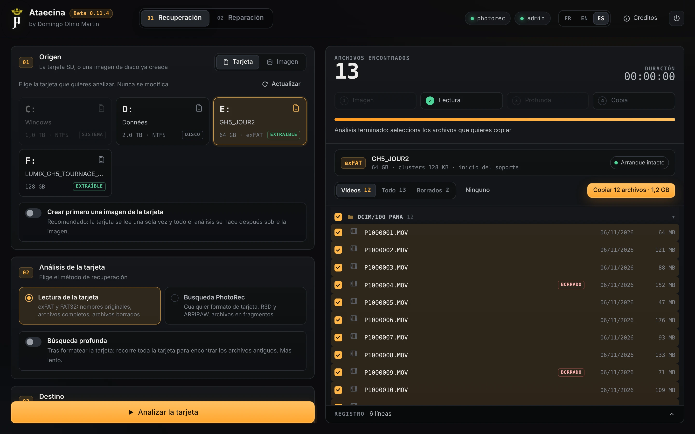
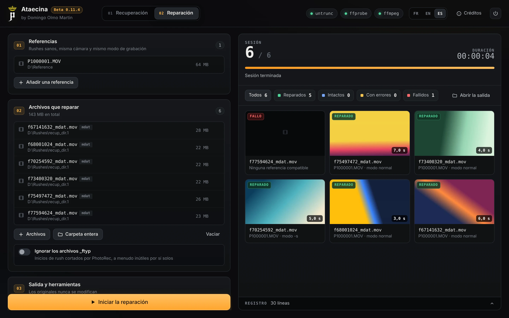

<p align="center">
  
</p>

<h1 align="center">Ataecina</h1>
<p align="center"><b>by Domingo Olmo Martin</b></p>
<p align="center">
  <a href="README.md">English</a> · <a href="README.fr.md">Français</a> · <b>Español</b>
</p>

Ataecina recupera las imágenes perdidas. Lee tarjetas de cámara (exFAT y FAT32), encuentra los archivos borrados y los de una tarjeta formateada por error, restaura el formato de una tarjeta dañada y repara los rushes MOV y MP4 rotos con un rush sano de referencia.

Gratuito, para Windows. Interfaz en español, francés e inglés.

> Ataecina es una diosa de la antigua península ibérica, a menudo interpretada como «la Renacida». Como ella, este programa devuelve a la luz imágenes que se creían perdidas.

<p align="center">
  
  <br><i>Recuperación: tarjeta leída, rushes borrados encontrados</i>
</p>

<p align="center">
  
  <br><i>Reparación: rushes reparados con una referencia</i>
</p>

## Descarga

Ve a la **[página de Releases](https://github.com/tetsujin28/ataecina/releases)**:

| Archivo | Uso |
|---|---|
| `Ataecina_x.y.z_portable.exe` | Sin instalación, basta con ejecutarlo |
| `Ataecina_x.y.z_x64-setup.exe` o `.msi` | Instalador |

**Primer inicio.** La aplicación aún no está firmada: Windows muestra un aviso una vez. Haz clic en «Más información» y luego en «Ejecutar de todas formas».

Leer una tarjeta directamente requiere derechos de administrador. Ataecina propone reiniciarse como administrador cuando hace falta.

## Qué hace

**Pestaña Recuperación**
- **Lectura de la tarjeta** (exFAT, FAT32): nombres y carpetas originales, archivos borrados, búsqueda profunda tras un formateo, restauración del sector de arranque desde su copia de seguridad.
- **Búsqueda PhotoRec**: todos los formatos de tarjeta, MOV / MP4 / BRAW, R3D, ARRIRAW, MXF, para archivos en trozos.
- **Imagen de la tarjeta** previa, con el método de GNU ddrescue: primero las zonas sanas, al final las dañadas, reanudación tras una interrupción.

**Pestaña Reparación**
- Reparación por lotes con untrunc y una o varias referencias, modo normal y luego modo paso a paso.
- Verificación con ffprobe (y decodificación completa con ffmpeg si se pide), miniaturas, `journal.csv`.

Los archivos originales nunca se modifican.

## Herramientas utilizadas

Ataecina controla estas herramientas gratuitas, que se instalan desde su sitio oficial:
- [untrunc](https://github.com/anthwlock/untrunc) (reparación)
- [FFmpeg](https://ffmpeg.org) (ffprobe y ffmpeg, verificaciones y miniaturas)
- [TestDisk / PhotoRec](https://www.cgsecurity.org) (búsqueda PhotoRec)

Colócalas junto a `Ataecina.exe`, en una carpeta `tools`, o en el PATH. Su ubicación también se puede indicar en la aplicación.

**Sin estas herramientas, la reparación no arranca.** El **[manual de uso completo](docs/GUIDE.es.md)** explica dónde descargarlas y cómo colocarlas, y describe paso a paso la recuperación y la reparación, con capturas comentadas.

## Compilación

Se necesitan Rust y la CLI de Tauri 2.

```
cargo test -p ataecina-core
cd src-tauri && cargo tauri build
```

El motor (`core`) incluye una herramienta de línea de comandos, `ataecina-cli`, usada para las pruebas.

## Licencia

MIT. © 2026 Domingo Olmo Martin.
