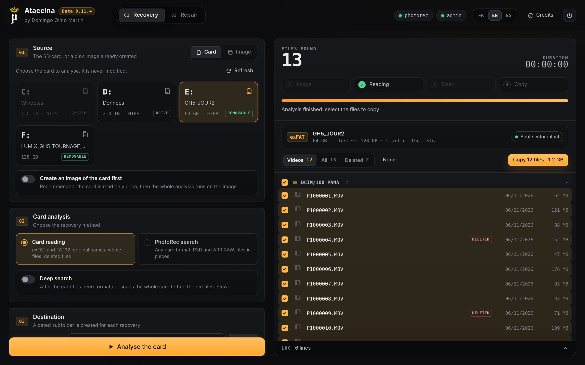
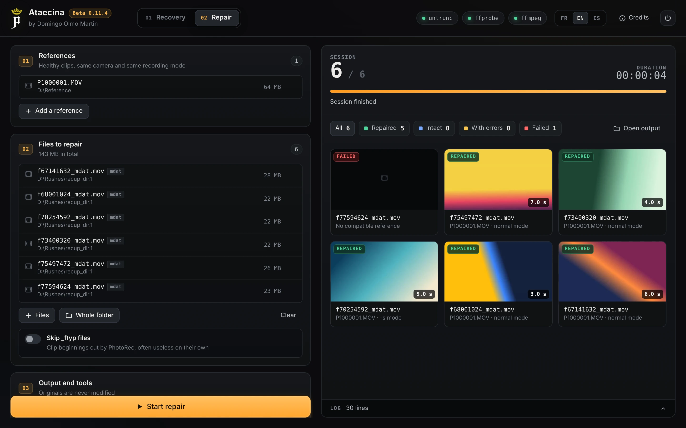

<p align="center">
  
</p>

<h1 align="center">Ataecina</h1>
<p align="center"><b>by Domingo Olmo Martin</b></p>
<p align="center">
  <b>English</b> · <a href="README.fr.md">Français</a> · <a href="README.es.md">Español</a>
</p>

Ataecina brings lost footage back. It reads camera cards (exFAT and FAT32), finds deleted files and files from a card that was formatted by mistake, restores a damaged card format, and repairs broken MOV and MP4 clips with a healthy reference clip.

Free, for Windows. Interface in English, French and Spanish.

> Ataecina is a goddess of the ancient Iberian Peninsula, often read as "the Reborn". Like her, this software brings back to light images we thought were lost.

<p align="center">
  
  <br><i>Recovery: card read, deleted clips found</i>
</p>

<p align="center">
  
  <br><i>Repair: clips repaired with a reference</i>
</p>

## Download

Go to the **[Releases page](https://github.com/tetsujin28/ataecina/releases)**:

| File | Use |
|---|---|
| `Ataecina_x.y.z_portable.exe` | No install, just run it |
| `Ataecina_x.y.z_x64-setup.exe` or `.msi` | Installer |

**First launch.** The app is not signed yet: Windows shows a warning once. Click "More info", then "Run anyway".

Reading a card directly needs administrator rights. Ataecina offers to restart itself as administrator when needed.

## What it does

**Recovery tab**
- **Card reading** (exFAT, FAT32): original names and folders, deleted files, deep search after a format, restore of the boot sector from its backup copy.
- **PhotoRec search**: every card format, MOV / MP4 / BRAW, R3D, ARRIRAW, MXF, for files in pieces.
- **Card image** first, using the GNU ddrescue method: healthy areas first, damaged areas last, resume after an interruption.

**Repair tab**
- Batch repair with untrunc and one or more reference clips, normal mode then step mode.
- Check with ffprobe (and a full decode with ffmpeg if asked), thumbnails, `journal.csv`.

Original files are never modified.

## Tools used

Ataecina drives these free tools, to install from their official site:
- [untrunc](https://github.com/anthwlock/untrunc) (repair)
- [FFmpeg](https://ffmpeg.org) (ffprobe and ffmpeg, checks and thumbnails)
- [TestDisk / PhotoRec](https://www.cgsecurity.org) (PhotoRec search)

Put them next to `Ataecina.exe`, in a `tools` folder, or in the PATH. Their location can also be set in the app.

## Build

Rust and the Tauri 2 CLI are required.

```
cargo test -p ataecina-core
cd src-tauri && cargo tauri build
```

The engine (`core`) has a command line tool, `ataecina-cli`, used for tests.

## License

MIT. © 2026 Domingo Olmo Martin.
