<p align="center">
  
</p>

<h1 align="center">Ataecina, manual de uso</h1>
<p align="center"><b>Beta 0.11.4 · Windows</b></p>
<p align="center">
  <a href="GUIDE.md">English</a> · <a href="GUIDE.fr.md">Français</a> · <b>Español</b>
</p>

> **⚠ Lee esto primero: Ataecina necesita programas complementarios.**
> untrunc, FFmpeg y PhotoRec **no** vienen incluidos con Ataecina. Descárgalos desde su web oficial y colócalos **en la misma carpeta que `Ataecina.exe`**. Sin ellos, la reparación no arranca y la búsqueda PhotoRec no está disponible. Ver la [sección 3](#3-instalar-los-programas-complementarios-imprescindible).

## Índice

1. [Presentación](#1-presentación)
2. [Instalación](#2-instalación)
3. [Instalar los programas complementarios (imprescindible)](#3-instalar-los-programas-complementarios-imprescindible)
4. [Antes de empezar: buenos hábitos](#4-antes-de-empezar-buenos-hábitos)
5. [Recuperación: leer la tarjeta](#5-recuperación-leer-la-tarjeta)
6. [Recuperación: tarjeta formateada por error](#6-recuperación-tarjeta-formateada-por-error)
7. [Recuperación: tarjeta ilegible, restaurar el formato](#7-recuperación-tarjeta-ilegible-restaurar-el-formato)
8. [Recuperación: imagen de la tarjeta y búsqueda PhotoRec](#8-recuperación-imagen-de-la-tarjeta-y-búsqueda-photorec)
9. [Reparación de MOV y MP4 rotos](#9-reparación-de-mov-y-mp4-rotos)
10. [Preguntas frecuentes](#10-preguntas-frecuentes)
11. [Aviso y licencia](#11-aviso-y-licencia)

## 1. Presentación

Ataecina devuelve el material perdido. Sirve en dos situaciones:

- **Recuperación**: una tarjeta de cámara se ha vaciado, se ha formateado por error o Windows ya no la lee. Ataecina lee la tarjeta por sí mismo (exFAT y FAT32), encuentra los archivos borrados y los de una tarjeta reformateada, puede restaurar el formato de una tarjeta dañada y recurre a PhotoRec para los casos más difíciles.
- **Reparación**: un rush MOV o MP4 ya no se abre, a menudo porque la cámara se apagó en plena grabación. Con untrunc y un rush sano de referencia, Ataecina reconstruye el índice que falta.

Los archivos originales y la tarjeta **nunca se modifican**, salvo si pides expresamente restaurar el formato (sección 7). Ataecina es gratuito, de código abierto (licencia MIT), para Windows.

> Ataecina es una diosa de la antigua península ibérica, a menudo interpretada como «la Renacida». Como ella, este programa devuelve a la luz imágenes que se creían perdidas.

## 2. Instalación

Los archivos están en la [página de Releases](https://github.com/tetsujin28/ataecina/releases):

| Archivo | Uso |
|---|---|
| `Ataecina_x.y.z_portable.exe` | Sin instalación: guárdalo en una carpeta propia, por ejemplo `C:\Ataecina\` |
| `Ataecina_x.y.z_x64-setup.exe` o `.msi` | Instalador clásico |

**Nuestro consejo: la versión portable.** La guardas en su propia carpeta y pones los programas complementarios justo al lado (sección 3). Con el instalador, el ejecutable queda en la carpeta de instalación (normalmente en `C:\Program Files\`), donde Windows pide permisos de administrador para añadir archivos.

**Primer arranque.** La app aún no está firmada: Windows muestra un aviso una vez. Haz clic en «Más información» y luego en «Ejecutar de todas formas».

**Permisos de administrador.** Leer una tarjeta directamente requiere permisos de administrador. Si hace falta, Ataecina muestra una franja y propone reiniciarse como administrador; Windows te pide que lo confirmes. La etiqueta **admin**, arriba a la derecha, pasa a verde.

## 3. Instalar los programas complementarios (imprescindible)

Ataecina utiliza tres programas gratuitos que **no** vienen con él. Siguen siendo propiedad de sus autores: descárgalos siempre desde su **web oficial**.

| Programa | Sirve para | Dónde encontrarlo | Archivos que colocar |
|---|---|---|---|
| **untrunc** | Reparar MOV / MP4 | [github.com/anthwlock/untrunc](https://github.com/anthwlock/untrunc), página Releases, versión Windows | `untrunc.exe` **y todos los archivos .dll** que lo acompañan |
| **FFmpeg** | Comprobar los archivos, crear las miniaturas | [ffmpeg.org](https://ffmpeg.org/download.html), apartado Windows (versiones compiladas por gyan.dev o BtbN) | `ffmpeg.exe` y `ffprobe.exe` (en la carpeta `bin` del archivo) |
| **TestDisk / PhotoRec** | La búsqueda PhotoRec | [cgsecurity.org](https://www.cgsecurity.org), TestDisk para Windows de 64 bits | la carpeta `testdisk-x.y` **entera** (contiene `photorec_win.exe` y sus archivos) |

### Dónde colocarlos

**Colócalos en la misma carpeta que `Ataecina.exe`.** Es el primer sitio donde Ataecina los busca:

```
C:\Ataecina\
├── Ataecina.exe
├── untrunc.exe          ← con los archivos .dll que trae untrunc
├── *.dll
├── ffmpeg.exe
├── ffprobe.exe
└── testdisk-7.2\        ← la carpeta de TestDisk tal cual
    ├── photorec_win.exe
    └── …
```

Si prefieres tenerlo ordenado, también funciona una subcarpeta `tools` junto a `Ataecina.exe`, con una carpeta por programa:

```
C:\Ataecina\
├── Ataecina.exe
└── tools\
    ├── untrunc\         (untrunc.exe y sus .dll)
    ├── ffmpeg\bin\      (ffmpeg.exe, ffprobe.exe)
    └── testdisk-7.2\    (photorec_win.exe…)
```

Dos reglas:

- **No separes nunca un programa de sus archivos .dll.** untrunc y PhotoRec no arrancan sin ellos. Copia todo el contenido del archivo comprimido, no solo el `.exe`.
- **Descomprime los archivos** (clic derecho, «Extraer todo»): Ataecina no mira dentro de un .zip.

Ataecina también encuentra las herramientas ya instaladas en el PATH de Windows. Y si las tienes en otro sitio, puedes indicar su ubicación a mano: campos **untrunc.exe** y **Carpeta de ffmpeg** de la pestaña Reparación, campo **photorec_win.exe** de la búsqueda PhotoRec.

### Comprobar que todo se detecta

Arriba a la derecha, unas **etiquetas** indican el estado de cada herramienta: **verde** = encontrada, **roja** = no encontrada.

Sin las herramientas, la pestaña Reparación muestra etiquetas rojas (1) y el campo untrunc.exe indica que no encuentra nada (2):

<p align="center">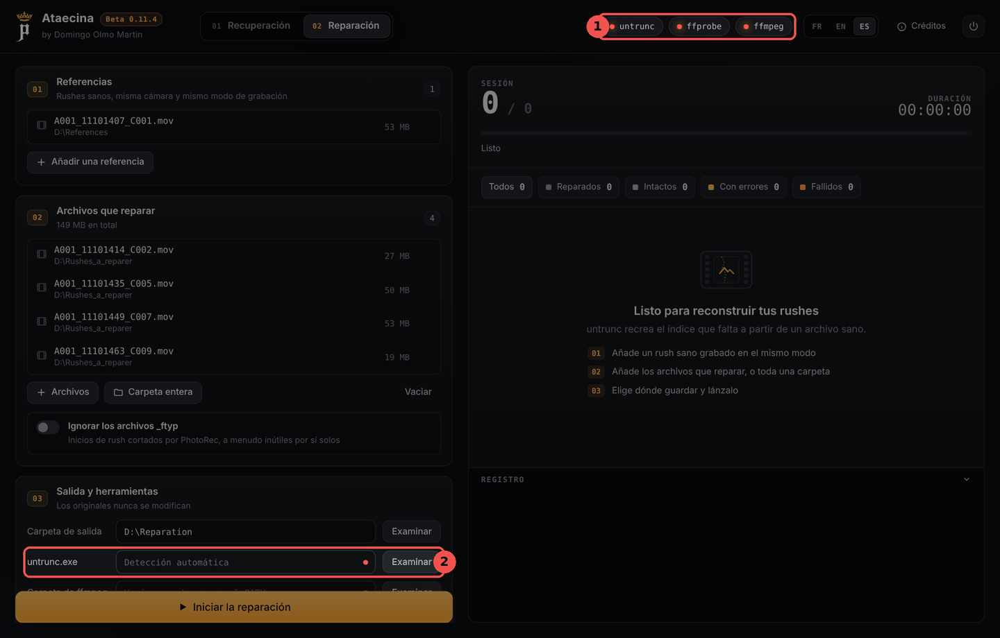</p>

Si lanzas la reparación de todos modos, Ataecina se detiene con un mensaje claro (1), por ejemplo «untrunc.exe no encontrado»:

<p align="center">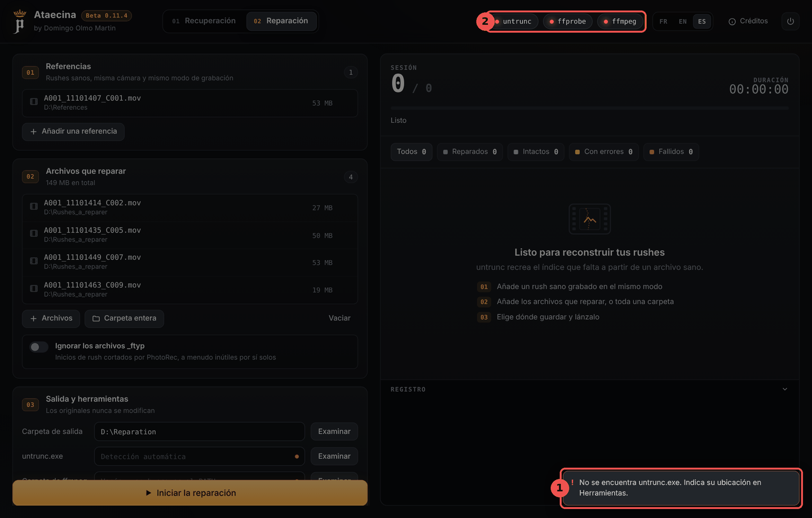</p>

Cuando las herramientas están junto al ejecutable, las etiquetas pasan a verde (1) y se muestra la ruta encontrada (2). Si siguen en rojo, cierra y vuelve a abrir Ataecina.

<p align="center">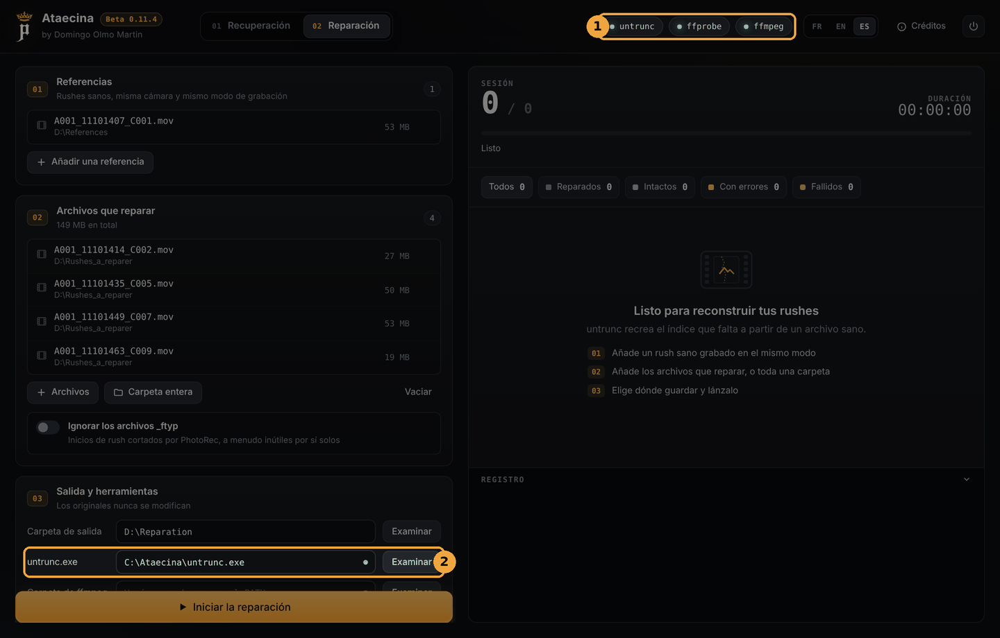</p>

En la pestaña Recuperación, la etiqueta **photorec** funciona igual:

<p align="center">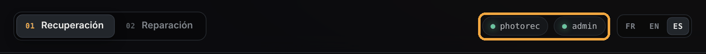</p>

**Lo que funciona sin las herramientas:** la lectura de la tarjeta, la búsqueda profunda, la copia de los archivos encontrados, la restauración del formato y la creación de una imagen de la tarjeta. **Lo que no funciona:** la búsqueda PhotoRec (sin PhotoRec) y toda la reparación (sin untrunc y FFmpeg).

## 4. Antes de empezar: buenos hábitos

- **No escribas nada más en la tarjeta.** No grabes con ella, no la formatees, no copies nada en ella. Cada escritura puede sobrescribir un rush todavía recuperable.
- **Si Windows propone formatear la tarjeta, dile que no.**
- **Elige siempre un destino en otro disco** que la tarjeta analizada. Ataecina lo recuerda debajo del campo Destino.
- **Para una tarjeta dañada, crea primero una imagen** (sección 8): la tarjeta se lee una sola vez y todo el trabajo se hace después sobre la imagen.

## 5. Recuperación: leer la tarjeta

Es el método que hay que probar primero. Ataecina lee por sí mismo el sistema de archivos exFAT o FAT32 de la tarjeta, sin escribir nada en ella, y recupera las carpetas y los nombres originales, incluidos los archivos borrados.

<p align="center">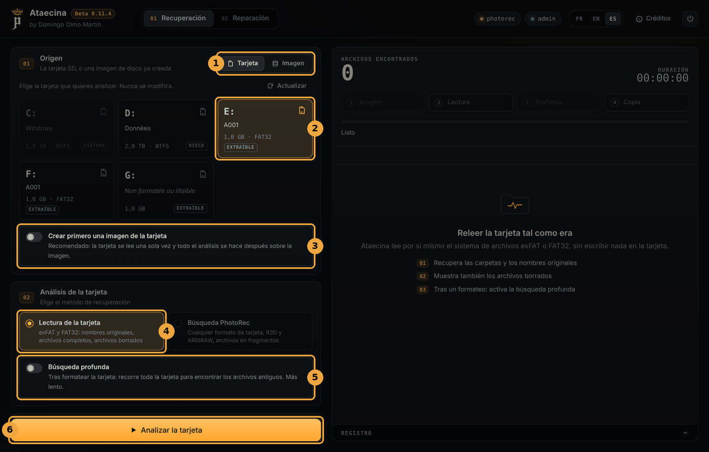</p>

1. **Origen**: *Tarjeta* para una tarjeta en el lector, *Imagen* para una imagen de disco ya creada.
2. **Elige la tarjeta** en la lista. Los discos del sistema aparecen atenuados. Si la tarjeta no aparece, haz clic en **Actualizar**.
3. **Crear primero una imagen de la tarjeta**: recomendado si la tarjeta parece dañada (sección 8).
4. **Método**: *Lectura de la tarjeta*.
5. **Búsqueda profunda**: solo después de un formateo (sección 6).
6. Comprueba el **Destino** (cada recuperación crea allí una subcarpeta con fecha) y haz clic en **Analizar la tarjeta**.

### Elegir los archivos que copiar

<p align="center">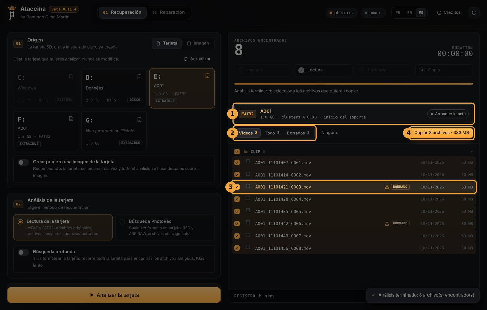</p>

1. La **ficha del volumen**: formato (exFAT o FAT32), nombre, tamaño y estado del sector de arranque.
2. Los **filtros**: *Vídeos*, *Todo*, *Borrados* (y *Recuperados* tras una búsqueda profunda). *Ninguno* / *Todos* desmarca o marca todo.
3. Los archivos **borrados** llevan la marca *BORRADO*, con un triángulo de aviso: sus datos pueden haberse sobrescrito en parte desde entonces.
4. **Copiar** copia los archivos marcados al destino. El botón indica su número y su tamaño.

<p align="center">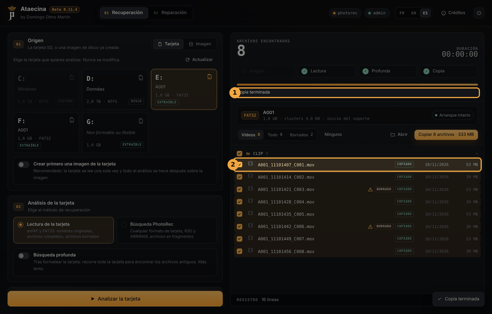</p>

Al terminar la copia (1), cada archivo tiene un estado (2): *COPIADO*, *POR REPARAR* (el archivo se ha copiado pero no se reproduce) o *ERROR*. **Abrir** muestra la carpeta de copia.

La opción **Enviar los vídeos a reparación** (debajo de Destino) añade directamente los vídeos que no se reproducen a la lista de la pestaña Reparación.

## 6. Recuperación: tarjeta formateada por error

Después de un formateo, la tarjeta parece vacía: la lectura simple no encuentra nada. Activa la **búsqueda profunda** y vuelve a lanzar el análisis.

<p align="center">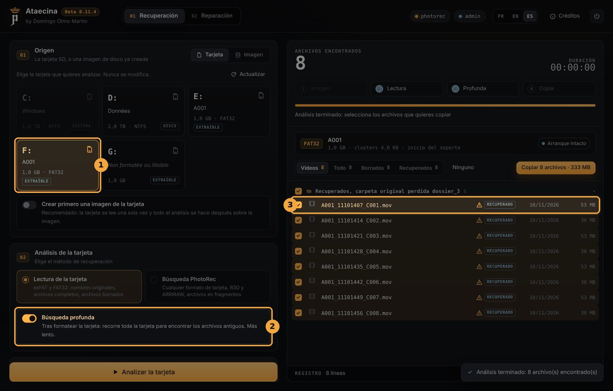</p>

1. Elige la tarjeta formateada.
2. Activa **Búsqueda profunda**. Ataecina recorre toda la tarjeta en busca de las antiguas entradas de archivos. Tarda más.
3. Los archivos encontrados llevan la marca *RECUPERADO* y se agrupan en «Recuperados, carpeta original perdida». Sus nombres originales suelen conservarse, pero la carpeta original se ha perdido y se supone que sus datos están en un solo bloque: compruébalos después de copiarlos.

Si la búsqueda profunda no da resultado, prueba la búsqueda PhotoRec (sección 8).

## 7. Recuperación: tarjeta ilegible, restaurar el formato

Cuando Windows ya no reconoce una tarjeta («el disco no está formateado»), a menudo es su sector de arranque el que está dañado. Las tarjetas exFAT y FAT32 guardan una **copia de seguridad** de él: Ataecina la usa para leer la tarjeta igualmente.

<p align="center">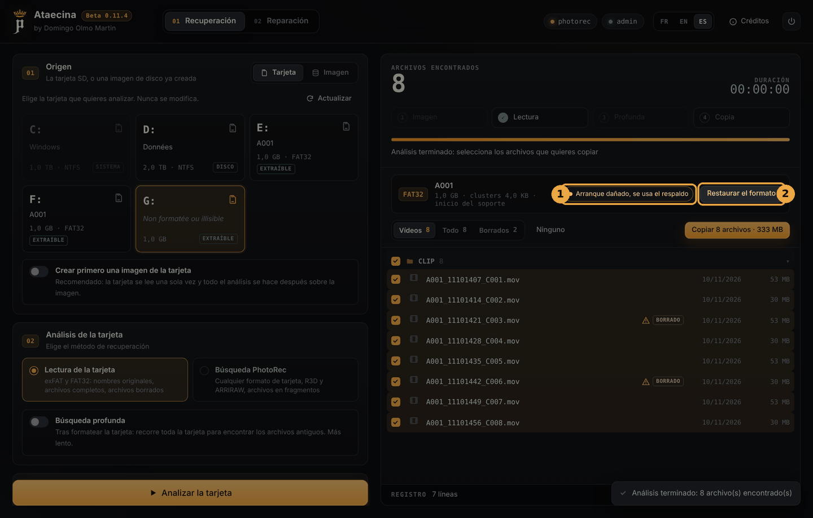</p>

1. La ficha del volumen indica *Arranque dañado, se usa el respaldo*. Los archivos se muestran con normalidad: **copia primero los que importan.**
2. **Restaurar el formato** reescribe el sector de arranque a partir de su copia de seguridad, para que Windows vuelva a leer la tarjeta.

<p align="center">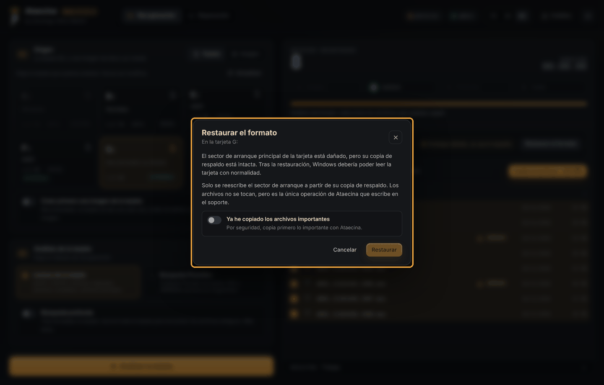</p>

Es **la única operación de Ataecina que escribe en la tarjeta**. Solo se reescribe el sector de arranque, los archivos no se tocan. Por seguridad, Ataecina te pide que confirmes que ya has copiado los archivos importantes antes de activar el botón **Restaurar**.

## 8. Recuperación: imagen de la tarjeta y búsqueda PhotoRec

### Crear una imagen de la tarjeta

Una tarjeta que empieza a fallar puede no aguantar varias lecturas. Activa **Crear primero una imagen de la tarjeta**: Ataecina la copia entera en un archivo de imagen, leyendo primero las zonas sanas y al final las dañadas, con el método de GNU ddrescue. Una copia interrumpida se puede reanudar. Todo el análisis se hace después sobre la imagen y la tarjeta puede guardarse.

Prevé **tanto espacio libre como el tamaño de la tarjeta**. El campo **Carpeta de imagen** permite elegir dónde guardarla (vacío = la carpeta de destino).

<p align="center">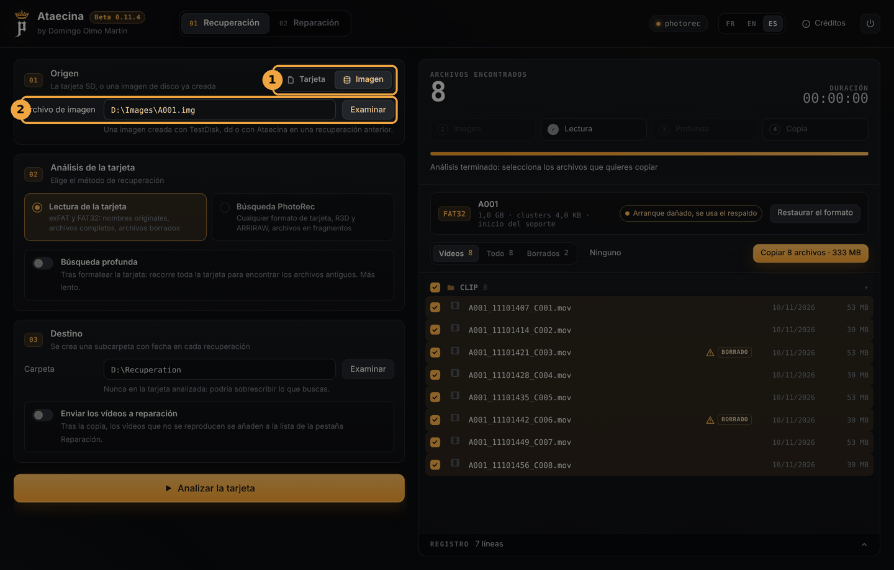</p>

Para analizar una imagen existente, elige **Imagen** (1) en el origen e indica el **archivo de imagen** (2): una imagen creada con Ataecina, TestDisk o dd.

### Búsqueda PhotoRec

Para los casos en los que la lectura de la tarjeta no basta: sistema de archivos destruido, formato de tarjeta desconocido, archivos dispersos en fragmentos. PhotoRec busca los vídeos directamente en los datos en bruto de la tarjeta. **PhotoRec tiene que estar instalado** (sección 3).

<p align="center">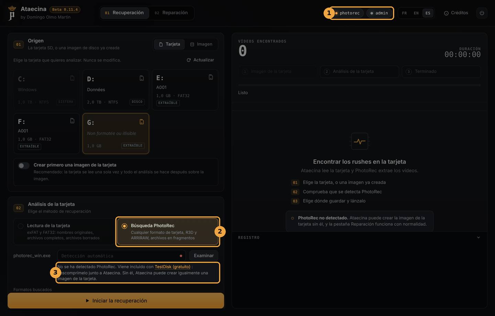</p>

1. La etiqueta **photorec** debe estar en verde.
2. Elige el método **Búsqueda PhotoRec**.
3. Si no se detecta PhotoRec, Ataecina lo indica aquí, con un enlace a TestDisk. También puedes indicar la ubicación de `photorec_win.exe` en el campo de arriba.

Elige los **formatos buscados** (MOV / MP4, R3D, ARRIRAW) y haz clic en **Iniciar la recuperación**. Los vídeos aparecen a medida que se encuentran. PhotoRec no recupera los nombres originales, y los archivos en fragmentos a menudo necesitan reparación: al final, Ataecina propone enviar los MOV a la pestaña Reparación.

## 9. Reparación de MOV y MP4 rotos

Un MOV o un MP4 contiene las imágenes y un **índice** que dice dónde están. Si la cámara se apaga durante la grabación, el índice nunca se escribe y el archivo ya no se abre. untrunc reconstruye ese índice basándose en un **rush sano de referencia**. Hacen falta **untrunc y FFmpeg** (sección 3).

<p align="center">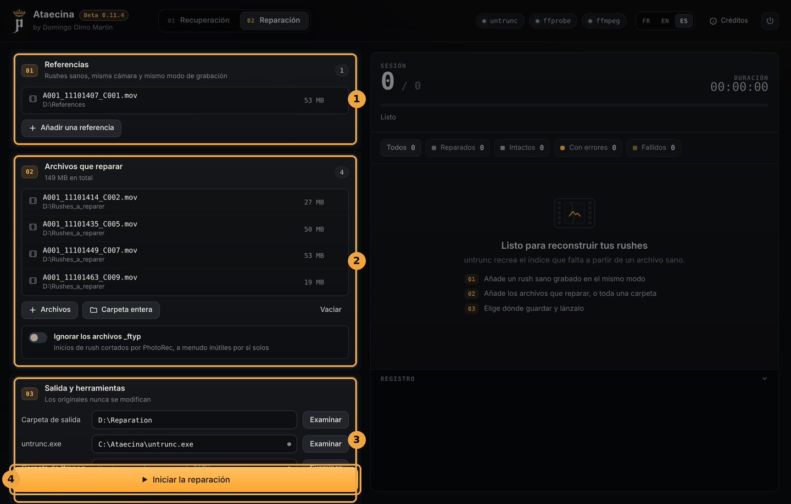</p>

1. **Referencias**: añade uno o varios rushes **sanos**, bastan unos segundos, grabados **con la misma cámara y el mismo modo de grabación** (resolución, cadencia, códec, bitrate) que los archivos perdidos. Es la condición de éxito más importante.
2. **Archivos que reparar**: añade los archivos uno a uno (**Archivos**) o una carpeta entera (**Carpeta entera**, por ejemplo la salida de PhotoRec). La opción **Ignorar los archivos _ftyp** descarta los inicios de rush cortados por PhotoRec, a menudo inútiles por sí solos.
3. **Salida y herramientas**: la **carpeta de salida** donde se escribirán los archivos reparados y la ubicación de las herramientas si Ataecina no las encuentra solo. **Verificación completa** decodifica entero cada archivo reparado con ffmpeg para contar los errores (más lento, más seguro).
4. Haz clic en **Iniciar la reparación**.

Para cada archivo, Ataecina comprueba primero si ya se reproduce. Si no, prueba untrunc con cada referencia, en modo normal y después en modo paso a paso, y se queda con el mejor resultado.

<p align="center">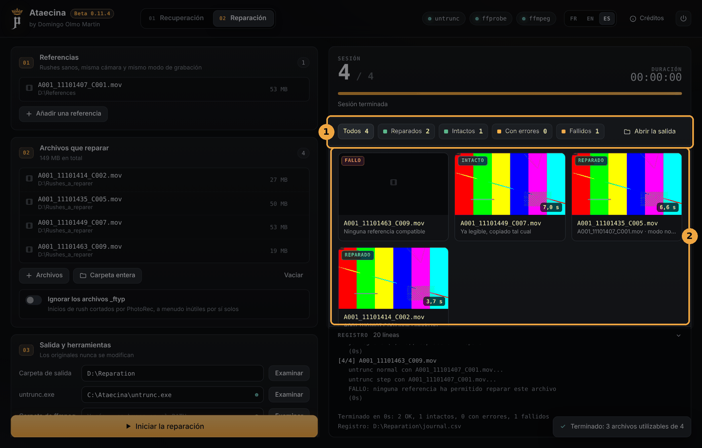</p>

1. El **balance**: *Reparados*, *Intactos*, *Con errores*, *Fallidos*. Un clic en una categoría filtra los resultados. **Abrir la salida** muestra la carpeta de salida.
2. Una **miniatura** por archivo, con la duración recuperada:
   - **REPARADO**: reconstruido, guardado como `<nombre>_repare.mov`;
   - **INTACTO**: ya se reproducía, copiado tal cual;
   - **ERRORES**: reconstruido, pero quedan errores de decodificación;
   - **FALLO**: ninguna referencia ha permitido repararlo. Prueba con otra referencia grabada exactamente en el mismo modo.

Los originales nunca se modifican. La carpeta de salida contiene también `journal.csv` (el balance de cada archivo, para abrir en una hoja de cálculo) y una carpeta `logs` con el detalle de cada intento de untrunc.

## 10. Preguntas frecuentes

**La reparación no arranca: «untrunc.exe no encontrado».**
untrunc no está junto a `Ataecina.exe`, o le faltan sus archivos .dll. Ver la sección 3.

**La etiqueta photorec sigue en rojo.**
La carpeta de TestDisk tiene que estar descomprimida y colocada entera junto a `Ataecina.exe` (o en `tools`). Si no, indica la ruta de `photorec_win.exe` en el campo previsto.

**Mi tarjeta no aparece en la lista.**
Haz clic en **Actualizar**. Comprueba que Ataecina se ejecuta como administrador. Si Windows no ve la tarjeta en absoluto (ni siquiera en el Explorador), el problema puede ser el lector o la tarjeta: prueba con otro lector.

**¿Ataecina funciona en Mac?**
No, Ataecina es solo para Windows.

**¿Qué tarjetas sabe leer Ataecina?**
La lectura de la tarjeta admite exFAT y FAT32, los formatos de casi todas las tarjetas de cámara. Para los demás casos, la búsqueda PhotoRec funciona con cualquier formato de tarjeta.

**Un archivo reparado es más corto de lo previsto.**
untrunc recupera todo lo aprovechable. Si el final del archivo nunca se llegó a escribir en la tarjeta, no se puede reconstruir.

## 11. Aviso y licencia

Ataecina es una herramienta de ayuda para recuperar y reparar medios. Se ofrece «tal cual», sin ninguna garantía: la recuperación nunca está garantizada y el autor no se hace responsable de ninguna pérdida, corrupción o eliminación de datos. Para material irremplazable en una tarjeta dañada físicamente, acude a un profesional de recuperación de datos antes de hacer nada.

untrunc, FFmpeg y TestDisk / PhotoRec siguen siendo propiedad de sus autores y se distribuyen con su propia licencia.

© 2026 Domingo Olmo Martin. Distribuido bajo [licencia MIT](../LICENSE).
