<p align="center">
  
</p>

<h1 align="center">Ataecina, mode d'emploi</h1>
<p align="center"><b>Version bêta 0.11.4 · Windows</b></p>
<p align="center">
  <a href="GUIDE.md">English</a> · <b>Français</b> · <a href="GUIDE.es.md">Español</a>
</p>

> **⚠ À lire avant tout : Ataecina a besoin de logiciels complémentaires.**
> untrunc, FFmpeg et PhotoRec ne sont **pas** fournis avec Ataecina. Téléchargez-les sur leur site officiel et placez-les **dans le même dossier que `Ataecina.exe`**. Sans eux, la réparation ne démarre pas et la recherche PhotoRec n'est pas disponible. Voir la [section 3](#3-installer-les-logiciels-complémentaires-indispensable).

## Sommaire

1. [Présentation](#1-présentation)
2. [Installation](#2-installation)
3. [Installer les logiciels complémentaires (indispensable)](#3-installer-les-logiciels-complémentaires-indispensable)
4. [Avant de commencer : les bons réflexes](#4-avant-de-commencer-les-bons-réflexes)
5. [Récupération : lire la carte](#5-récupération-lire-la-carte)
6. [Récupération : carte formatée par erreur](#6-récupération-carte-formatée-par-erreur)
7. [Récupération : carte illisible, restaurer le format](#7-récupération-carte-illisible-restaurer-le-format)
8. [Récupération : image de la carte et recherche PhotoRec](#8-récupération-image-de-la-carte-et-recherche-photorec)
9. [Réparation des MOV et MP4 cassés](#9-réparation-des-mov-et-mp4-cassés)
10. [Questions fréquentes](#10-questions-fréquentes)
11. [Avertissement et licence](#11-avertissement-et-licence)

## 1. Présentation

Ataecina ramène les images perdues. Il sert dans deux situations :

- **Récupération** : une carte caméra a été vidée, formatée par erreur, ou Windows ne la lit plus. Ataecina lit lui-même la carte (exFAT et FAT32), retrouve les fichiers supprimés et ceux d'une carte reformatée, peut restaurer le format d'une carte abîmée, et sait faire appel à PhotoRec pour les cas les plus difficiles.
- **Réparation** : un rush MOV ou MP4 ne s'ouvre plus, souvent parce que la caméra s'est éteinte en plein enregistrement. Avec untrunc et un rush sain de référence, Ataecina reconstruit l'index manquant.

Les fichiers d'origine et la carte **ne sont jamais modifiés**, sauf si vous demandez explicitement la restauration du format (section 7). Ataecina est gratuit, open source (licence MIT), pour Windows.

> Ataecina est une déesse de la péninsule ibérique antique, souvent interprétée comme « la Renaissante ». Comme elle, ce logiciel ramène à la lumière des images que l'on croyait perdues.

## 2. Installation

Les fichiers se trouvent sur la [page des Releases](https://github.com/tetsujin28/ataecina/releases) :

| Fichier | Usage |
|---|---|
| `Ataecina_x.y.z_portable.exe` | Sans installation : placez-le dans un dossier à vous, par exemple `C:\Ataecina\` |
| `Ataecina_x.y.z_x64-setup.exe` ou `.msi` | Installeur classique |

**Notre conseil : la version portable.** Vous la rangez dans un dossier dédié, et vous mettez les logiciels complémentaires juste à côté (section 3). Avec l'installeur, l'exécutable se trouve dans le dossier d'installation (en général sous `C:\Program Files\`), où Windows demande les droits administrateur pour ajouter des fichiers.

**Premier lancement.** L'application n'est pas encore signée : Windows affiche un avertissement une fois. Cliquez sur « Informations complémentaires », puis sur « Exécuter quand même ».

**Droits administrateur.** Lire une carte directement demande les droits administrateur. Si besoin, Ataecina affiche un bandeau et propose de se relancer en administrateur ; Windows vous demande alors de confirmer. La pastille **admin**, en haut à droite, passe au vert.

## 3. Installer les logiciels complémentaires (indispensable)

Ataecina pilote trois logiciels gratuits qui ne sont **pas** livrés avec lui. Ils restent la propriété de leurs auteurs : téléchargez-les toujours depuis leur **site officiel**.

| Logiciel | Sert à | Où le trouver | Fichiers à placer |
|---|---|---|---|
| **untrunc** | Réparer les MOV / MP4 | [github.com/anthwlock/untrunc](https://github.com/anthwlock/untrunc), page Releases, version Windows | `untrunc.exe` **et tous les fichiers .dll** livrés avec lui |
| **FFmpeg** | Vérifier les fichiers, créer les vignettes | [ffmpeg.org](https://ffmpeg.org/download.html), rubrique Windows (versions compilées par gyan.dev ou BtbN) | `ffmpeg.exe` et `ffprobe.exe` (dans le dossier `bin` de l'archive) |
| **TestDisk / PhotoRec** | La recherche PhotoRec | [cgsecurity.org](https://www.cgsecurity.org), TestDisk pour Windows 64 bits | le dossier `testdisk-x.y` **entier** (il contient `photorec_win.exe` et ses fichiers) |

### Où les mettre

**Placez-les dans le même dossier que `Ataecina.exe`.** C'est l'endroit où Ataecina les cherche en premier :

```
C:\Ataecina\
├── Ataecina.exe
├── untrunc.exe          ← avec les fichiers .dll livrés avec untrunc
├── *.dll
├── ffmpeg.exe
├── ffprobe.exe
└── testdisk-7.2\        ← le dossier de TestDisk tel quel
    ├── photorec_win.exe
    └── …
```

Si vous préférez garder les choses rangées, un sous-dossier `tools` à côté de `Ataecina.exe` fonctionne aussi, avec un dossier par logiciel :

```
C:\Ataecina\
├── Ataecina.exe
└── tools\
    ├── untrunc\         (untrunc.exe et ses .dll)
    ├── ffmpeg\bin\      (ffmpeg.exe, ffprobe.exe)
    └── testdisk-7.2\    (photorec_win.exe…)
```

Deux règles à respecter :

- **Ne séparez jamais un logiciel de ses fichiers .dll.** untrunc et PhotoRec ne démarrent pas sans eux. Copiez tout le contenu de l'archive, pas seulement le `.exe`.
- **Décompressez les archives** (clic droit, « Extraire tout ») : Ataecina ne lit pas l'intérieur d'un fichier .zip.

Ataecina trouve aussi les outils déjà installés dans le PATH de Windows. Et si vous les avez rangés ailleurs, vous pouvez indiquer leur emplacement à la main : champs **untrunc.exe** et **Dossier ffmpeg** de l'onglet Réparation, champ **photorec_win.exe** de la recherche PhotoRec.

### Vérifier que tout est détecté

En haut à droite, des **pastilles** indiquent l'état de chaque outil : **verte** = trouvé, **rouge** = introuvable.

Sans les outils, l'onglet Réparation affiche des pastilles rouges (1) et le champ untrunc.exe signale qu'il ne trouve rien (2) :

<p align="center">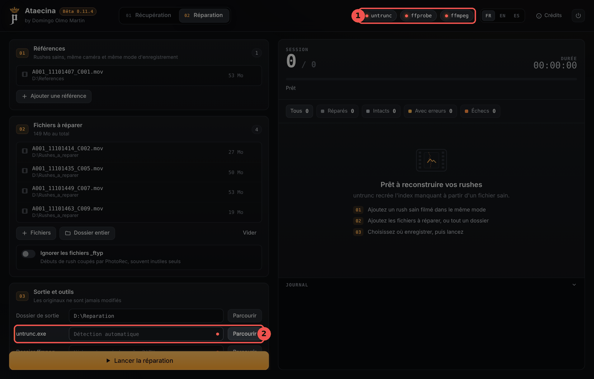</p>

Si vous lancez quand même la réparation, Ataecina s'arrête avec un message clair (1), par exemple « untrunc.exe introuvable » :

<p align="center">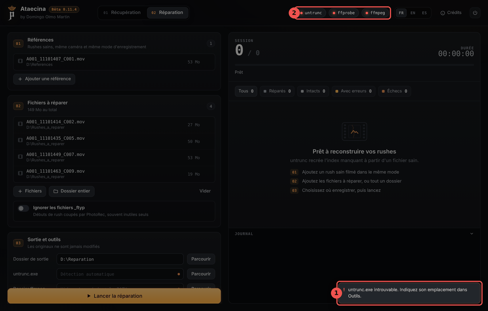</p>

Une fois les outils placés à côté de l'exécutable, les pastilles passent au vert (1) et le chemin trouvé s'affiche (2). Si elles restent rouges, fermez et relancez Ataecina.

<p align="center">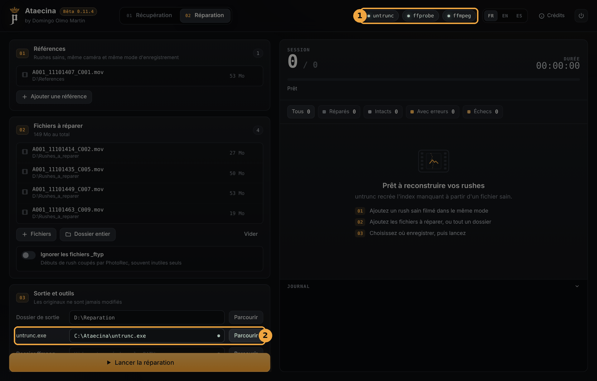</p>

Dans l'onglet Récupération, la pastille **photorec** fait de même :

<p align="center">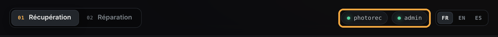</p>

**Ce qui marche sans les outils :** la lecture de la carte, la recherche approfondie, la copie des fichiers retrouvés, la restauration du format et la création d'une image de carte. **Ce qui ne marche pas :** la recherche PhotoRec (sans PhotoRec) et toute la réparation (sans untrunc et FFmpeg).

## 4. Avant de commencer : les bons réflexes

- **N'écrivez plus rien sur la carte.** Ne filmez plus avec, ne la formatez pas, ne copiez rien dessus. Chaque écriture peut écraser un rush encore récupérable.
- **Si Windows propose de formater la carte, refusez.**
- **Choisissez toujours une destination sur un autre disque** que la carte analysée. Ataecina le rappelle sous le champ Destination.
- **Pour une carte abîmée, créez d'abord une image** (section 8) : la carte n'est lue qu'une fois, et tout le travail se fait ensuite sur l'image.

## 5. Récupération : lire la carte

C'est la méthode à essayer en premier. Ataecina lit lui-même le système de fichiers exFAT ou FAT32 de la carte, sans rien y écrire, et retrouve les dossiers et les noms d'origine, y compris les fichiers supprimés.

<p align="center">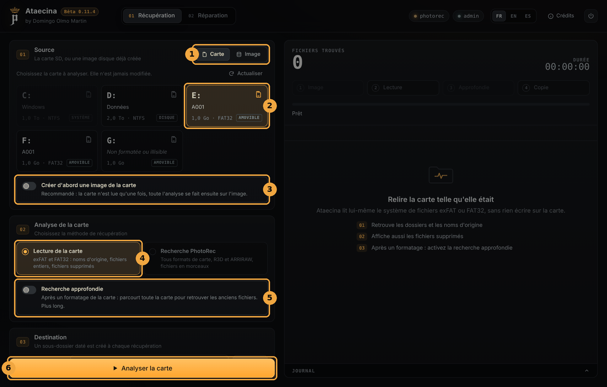</p>

1. **Source** : *Carte* pour une carte insérée dans le lecteur, *Image* pour une image disque déjà créée.
2. **Choisissez la carte** dans la liste. Les disques système sont grisés. Si la carte n'apparaît pas, cliquez sur **Actualiser**.
3. **Créer d'abord une image de la carte** : recommandé si la carte semble abîmée (section 8).
4. **Méthode** : *Lecture de la carte*.
5. **Recherche approfondie** : seulement après un formatage (section 6).
6. Vérifiez la **Destination** (un sous-dossier daté y est créé à chaque récupération), puis cliquez sur **Analyser la carte**.

### Choisir les fichiers à copier

<p align="center">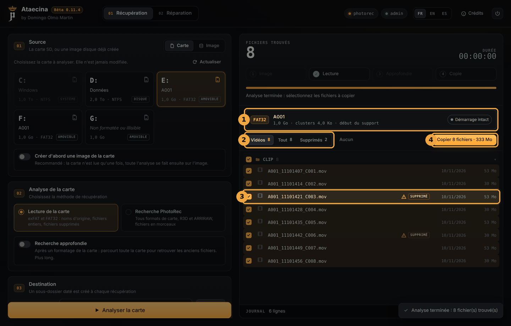</p>

1. La **fiche du volume** : format (exFAT ou FAT32), nom, taille, et l'état du secteur de démarrage.
2. Les **filtres** : *Vidéos*, *Tout*, *Supprimés* (et *Retrouvés* après une recherche approfondie). *Aucun* / *Tous* décoche ou coche tout.
3. Les fichiers **supprimés** sont marqués *SUPPRIMÉ*, avec un triangle d'avertissement : leurs données ont pu être en partie réécrites depuis.
4. **Copier** copie les fichiers cochés vers la destination. Le bouton indique leur nombre et leur taille.

<p align="center">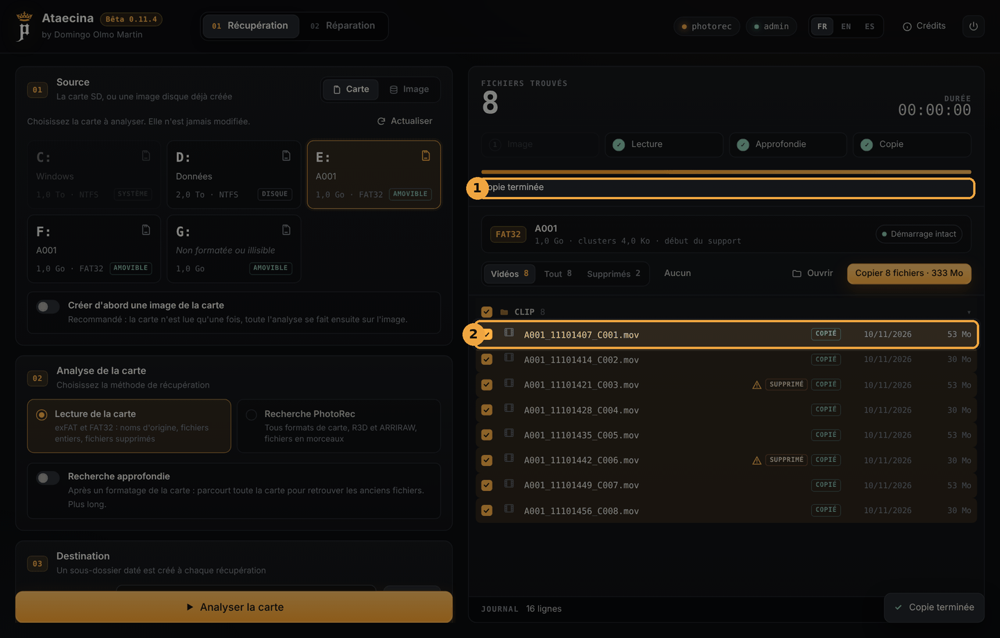</p>

À la fin de la copie (1), chaque fichier porte un statut (2) : *COPIÉ*, *À RÉPARER* (le fichier a été copié mais ne se lit pas) ou *ERREUR*. **Ouvrir** affiche le dossier de copie.

L'option **Envoyer les vidéos vers la réparation** (sous Destination) ajoute directement les vidéos illisibles à la liste de l'onglet Réparation.

## 6. Récupération : carte formatée par erreur

Après un formatage, la carte paraît vide : la lecture simple ne trouve rien. Activez la **recherche approfondie** et relancez l'analyse.

<p align="center">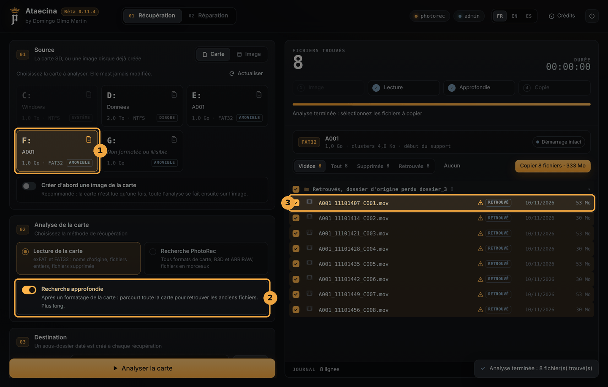</p>

1. Choisissez la carte formatée.
2. Activez **Recherche approfondie**. Ataecina parcourt toute la carte à la recherche des anciennes entrées de fichiers. C'est plus long.
3. Les fichiers retrouvés sont marqués *RETROUVÉ* et rangés dans « Retrouvés, dossier d'origine perdu ». Leurs noms d'origine sont souvent conservés, mais le dossier d'origine est perdu, et leurs données sont supposées d'un seul tenant : vérifiez-les après la copie.

Si la recherche approfondie ne donne rien, essayez la recherche PhotoRec (section 8).

## 7. Récupération : carte illisible, restaurer le format

Quand Windows ne reconnaît plus une carte (« le disque n'est pas formaté »), c'est souvent son secteur de démarrage qui est abîmé. Les cartes exFAT et FAT32 en gardent une **copie de secours** : Ataecina s'en sert pour lire la carte quand même.

<p align="center">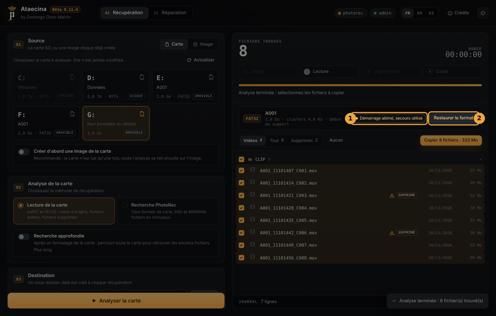</p>

1. La fiche du volume indique *Démarrage abîmé, secours utilisé*. Les fichiers s'affichent normalement : **copiez d'abord ceux qui comptent.**
2. **Restaurer le format** réécrit le secteur de démarrage à partir de sa copie de secours, pour que Windows lise de nouveau la carte.

<p align="center">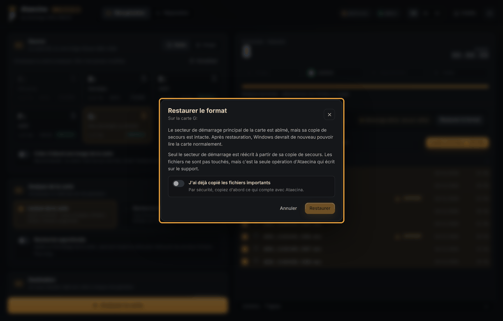</p>

C'est **la seule opération d'Ataecina qui écrit sur la carte**. Seul le secteur de démarrage est réécrit, les fichiers ne sont pas touchés. Par sécurité, Ataecina vous demande de confirmer que vous avez déjà copié les fichiers importants avant d'activer le bouton **Restaurer**.

## 8. Récupération : image de la carte et recherche PhotoRec

### Créer une image de la carte

Une carte qui commence à lâcher peut ne pas supporter plusieurs lectures. Activez **Créer d'abord une image de la carte** : Ataecina la copie entièrement dans un fichier image, en lisant les zones saines d'abord et les zones abîmées en dernier, selon la méthode de GNU ddrescue. Une copie interrompue peut être reprise. Toute l'analyse se fait ensuite sur l'image, la carte peut être rangée.

Prévoyez **autant d'espace libre que la taille de la carte**. Le champ **Dossier image** permet de choisir où l'enregistrer (vide = le dossier de destination).

<p align="center">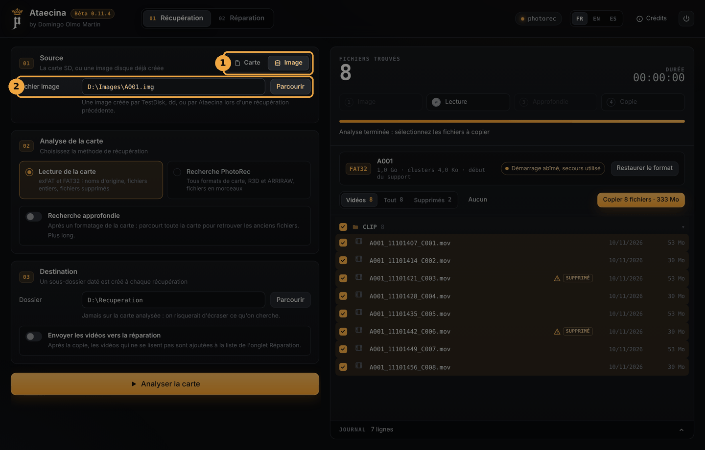</p>

Pour analyser une image existante, choisissez **Image** (1) dans la source, puis indiquez le **fichier image** (2) : une image créée par Ataecina, par TestDisk ou par dd.

### Recherche PhotoRec

Pour les cas où la lecture de la carte ne suffit pas : système de fichiers détruit, format de carte inconnu, fichiers éparpillés en morceaux. PhotoRec cherche les vidéos directement dans les données brutes de la carte. Il faut que **PhotoRec soit installé** (section 3).

<p align="center">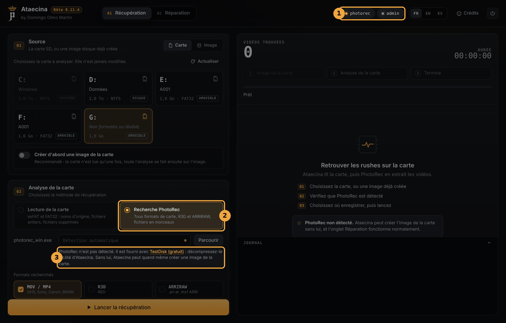</p>

1. La pastille **photorec** doit être verte.
2. Choisissez la méthode **Recherche PhotoRec**.
3. Si PhotoRec n'est pas détecté, Ataecina l'indique ici, avec un lien vers TestDisk. Vous pouvez aussi indiquer l'emplacement de `photorec_win.exe` dans le champ au-dessus.

Choisissez les **formats recherchés** (MOV / MP4, R3D, ARRIRAW), puis cliquez sur **Lancer la récupération**. Les vidéos apparaissent au fur et à mesure. PhotoRec ne retrouve pas les noms d'origine, et les fichiers en morceaux ont souvent besoin d'une réparation : à la fin, Ataecina propose d'envoyer les MOV vers l'onglet Réparation.

## 9. Réparation des MOV et MP4 cassés

Un MOV ou un MP4 contient les images et un **index** qui dit où elles se trouvent. Si la caméra s'éteint pendant l'enregistrement, l'index n'est jamais écrit et le fichier ne s'ouvre plus. untrunc reconstruit cet index en s'appuyant sur un **rush sain de référence**. Il faut **untrunc et FFmpeg** (section 3).

<p align="center">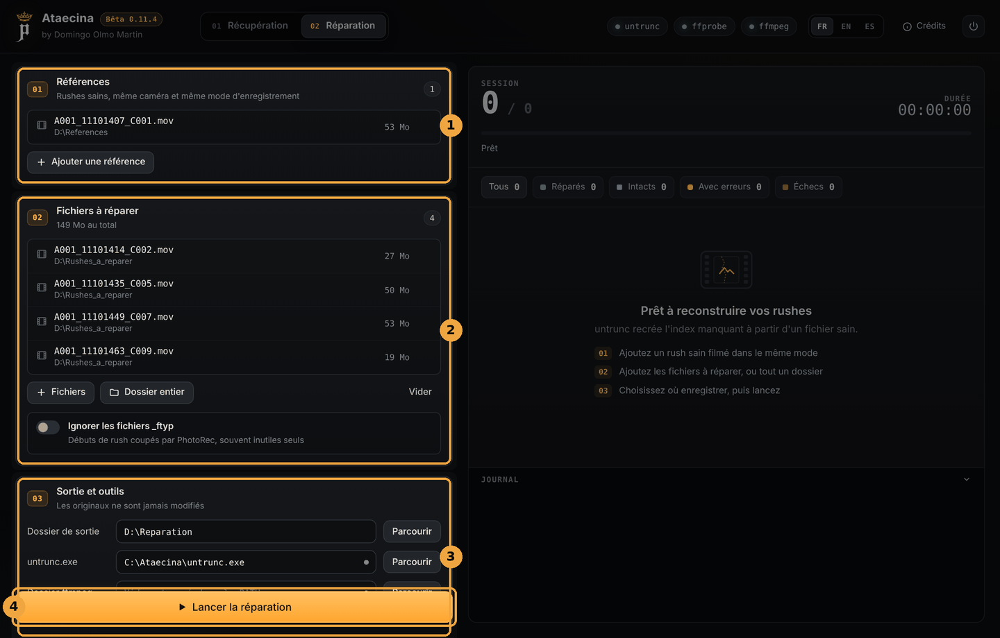</p>

1. **Références** : ajoutez un ou plusieurs rushes **sains**, de quelques secondes suffisent, filmés **avec la même caméra et le même mode d'enregistrement** (résolution, cadence, codec, débit) que les fichiers perdus. C'est la condition de réussite la plus importante.
2. **Fichiers à réparer** : ajoutez les fichiers un par un (**Fichiers**) ou un dossier entier (**Dossier entier**, par exemple la sortie de PhotoRec). L'option **Ignorer les fichiers _ftyp** écarte les débuts de rush coupés par PhotoRec, souvent inutiles seuls.
3. **Sortie et outils** : le **dossier de sortie** où seront écrits les fichiers réparés, et l'emplacement des outils si Ataecina ne les trouve pas seul. **Vérification complète** décode chaque fichier réparé en entier avec ffmpeg pour compter les erreurs (plus long, plus sûr).
4. Cliquez sur **Lancer la réparation**.

Pour chaque fichier, Ataecina vérifie d'abord s'il se lit déjà. Sinon, il essaie untrunc avec chaque référence, en mode normal puis en mode pas à pas, et garde le meilleur résultat.

<p align="center">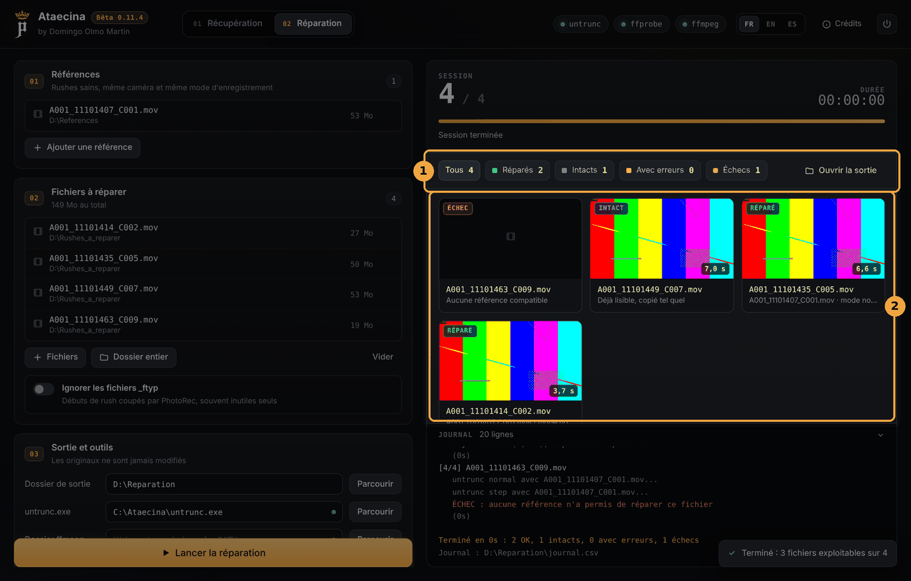</p>

1. Le **bilan** : *Réparés*, *Intacts*, *Avec erreurs*, *Échecs*. Un clic sur une catégorie filtre les résultats. **Ouvrir la sortie** affiche le dossier de sortie.
2. Une **vignette** par fichier, avec sa durée récupérée :
   - **RÉPARÉ** : reconstruit, enregistré sous `<nom>_repare.mov` ;
   - **INTACT** : se lisait déjà, copié tel quel ;
   - **ERREURS** : reconstruit, mais des erreurs de décodage subsistent ;
   - **ÉCHEC** : aucune référence n'a permis de le réparer. Essayez une autre référence, filmée exactement dans le même mode.

Les originaux ne sont jamais modifiés. Le dossier de sortie contient aussi `journal.csv` (le bilan de chaque fichier, à ouvrir dans un tableur) et un dossier `logs` avec le détail de chaque essai d'untrunc.

## 10. Questions fréquentes

**La réparation ne démarre pas : « untrunc.exe introuvable ».**
untrunc n'est pas à côté de `Ataecina.exe`, ou ses fichiers .dll manquent. Voir la section 3.

**La pastille photorec reste rouge.**
Le dossier de TestDisk doit être décompressé, et rangé entier à côté de `Ataecina.exe` (ou dans `tools`). Sinon, indiquez le chemin de `photorec_win.exe` dans le champ prévu.

**Ma carte n'apparaît pas dans la liste.**
Cliquez sur **Actualiser**. Vérifiez qu'Ataecina tourne en administrateur. Si Windows ne voit pas du tout la carte (même pas dans l'Explorateur), le lecteur ou la carte peut être en cause : essayez un autre lecteur.

**Ataecina fonctionne-t-il sur Mac ?**
Non, Ataecina est pour Windows uniquement.

**Quelles cartes Ataecina sait-il lire ?**
La lecture de la carte gère exFAT et FAT32, les formats de la quasi-totalité des cartes de caméra. Pour les autres cas, la recherche PhotoRec fonctionne avec tous les formats de carte.

**Un fichier réparé est plus court que prévu.**
untrunc récupère tout ce qui est exploitable. Si la fin du fichier n'a jamais été écrite sur la carte, elle ne peut pas être reconstruite.

## 11. Avertissement et licence

Ataecina est un outil d'aide à la récupération et à la réparation de médias. Il est fourni « en l'état », sans aucune garantie : la récupération n'est jamais garantie, et l'auteur ne saurait être tenu responsable de toute perte, corruption ou suppression de données. Pour des rushes irremplaçables sur une carte physiquement endommagée, adressez-vous à un professionnel de la récupération de données avant toute manipulation.

untrunc, FFmpeg et TestDisk / PhotoRec restent la propriété de leurs auteurs et sont distribués sous leur propre licence.

© 2026 Domingo Olmo Martin. Distribué sous [licence MIT](../LICENSE).
