<p align="center">
  
</p>

<h1 align="center">Ataecina user guide</h1>
<p align="center"><b>Beta 0.11.4 · Windows</b></p>
<p align="center">
  <b>English</b> · <a href="GUIDE.fr.md">Français</a> · <a href="GUIDE.es.md">Español</a>
</p>

> **⚠ Read this first: Ataecina needs additional software.**
> untrunc, FFmpeg and PhotoRec are **not** included with Ataecina. Download them from their official websites and put them **in the same folder as `Ataecina.exe`**. Without them, repair does not start and the PhotoRec search is not available. See [section 3](#3-installing-the-additional-software-required).

## Contents

1. [Overview](#1-overview)
2. [Installation](#2-installation)
3. [Installing the additional software (required)](#3-installing-the-additional-software-required)
4. [Before you start: good habits](#4-before-you-start-good-habits)
5. [Recovery: reading the card](#5-recovery-reading-the-card)
6. [Recovery: card formatted by mistake](#6-recovery-card-formatted-by-mistake)
7. [Recovery: unreadable card, restoring the format](#7-recovery-unreadable-card-restoring-the-format)
8. [Recovery: card image and PhotoRec search](#8-recovery-card-image-and-photorec-search)
9. [Repairing broken MOV and MP4 files](#9-repairing-broken-mov-and-mp4-files)
10. [FAQ](#10-faq)
11. [Disclaimer and license](#11-disclaimer-and-license)

## 1. Overview

Ataecina brings lost footage back. It helps in two situations:

- **Recovery**: a camera card was emptied, formatted by mistake, or Windows can no longer read it. Ataecina reads the card itself (exFAT and FAT32), finds deleted files and those of a reformatted card, can restore the format of a damaged card, and can call on PhotoRec for the hardest cases.
- **Repair**: a MOV or MP4 clip no longer opens, often because the camera shut down while recording. With untrunc and a healthy reference clip, Ataecina rebuilds the missing index.

The original files and the card are **never modified**, unless you explicitly ask to restore the format (section 7). Ataecina is free, open source (MIT License), for Windows.

> Ataecina is a goddess of the ancient Iberian Peninsula, often interpreted as "the Reborn". Like her, this software brings back to light images that were thought to be lost.

## 2. Installation

The files are on the [Releases page](https://github.com/tetsujin28/ataecina/releases):

| File | Use |
|---|---|
| `Ataecina_x.y.z_portable.exe` | No install: put it in a folder of your own, for example `C:\Ataecina\` |
| `Ataecina_x.y.z_x64-setup.exe` or `.msi` | Standard installer |

**Our advice: the portable version.** You keep it in its own folder and put the additional software right next to it (section 3). With the installer, the executable lives in the installation folder (usually under `C:\Program Files\`), where Windows asks for administrator rights to add files.

**First launch.** The app is not signed yet, so Windows shows a warning once. Click "More info", then "Run anyway".

**Administrator rights.** Reading a card directly requires administrator rights. When needed, Ataecina shows a banner and offers to restart as administrator; Windows asks you to confirm. The **admin** pill, top right, turns green.

## 3. Installing the additional software (required)

Ataecina drives three free programs that are **not** shipped with it. They remain the property of their authors: always download them from their **official website**.

| Software | Used for | Where to get it | Files to place |
|---|---|---|---|
| **untrunc** | Repairing MOV / MP4 | [github.com/anthwlock/untrunc](https://github.com/anthwlock/untrunc), Releases page, Windows build | `untrunc.exe` **and all the .dll files** that come with it |
| **FFmpeg** | Checking files, creating thumbnails | [ffmpeg.org](https://ffmpeg.org/download.html), Windows section (builds by gyan.dev or BtbN) | `ffmpeg.exe` and `ffprobe.exe` (in the archive's `bin` folder) |
| **TestDisk / PhotoRec** | The PhotoRec search | [cgsecurity.org](https://www.cgsecurity.org), TestDisk for Windows 64-bit | the **whole** `testdisk-x.y` folder (it contains `photorec_win.exe` and its files) |

### Where to put them

**Put them in the same folder as `Ataecina.exe`.** That is where Ataecina looks first:

```
C:\Ataecina\
├── Ataecina.exe
├── untrunc.exe          ← with the .dll files shipped with untrunc
├── *.dll
├── ffmpeg.exe
├── ffprobe.exe
└── testdisk-7.2\        ← the TestDisk folder as it is
    ├── photorec_win.exe
    └── …
```

If you prefer to keep things tidy, a `tools` subfolder next to `Ataecina.exe` also works, with one folder per program:

```
C:\Ataecina\
├── Ataecina.exe
└── tools\
    ├── untrunc\         (untrunc.exe and its .dll files)
    ├── ffmpeg\bin\      (ffmpeg.exe, ffprobe.exe)
    └── testdisk-7.2\    (photorec_win.exe…)
```

Two rules:

- **Never separate a program from its .dll files.** untrunc and PhotoRec do not start without them. Copy the whole content of the archive, not just the `.exe`.
- **Unzip the archives** (right-click, "Extract All"): Ataecina does not look inside a .zip file.

Ataecina also finds tools already installed in the Windows PATH. And if you keep them somewhere else, you can set their location by hand: the **untrunc.exe** and **ffmpeg folder** fields in the Repair tab, the **photorec_win.exe** field of the PhotoRec search.

### Checking that everything is detected

Top right, **pills** show the state of each tool: **green** = found, **red** = not found.

Without the tools, the Repair tab shows red pills (1) and the untrunc.exe field shows that nothing was found (2):

<p align="center">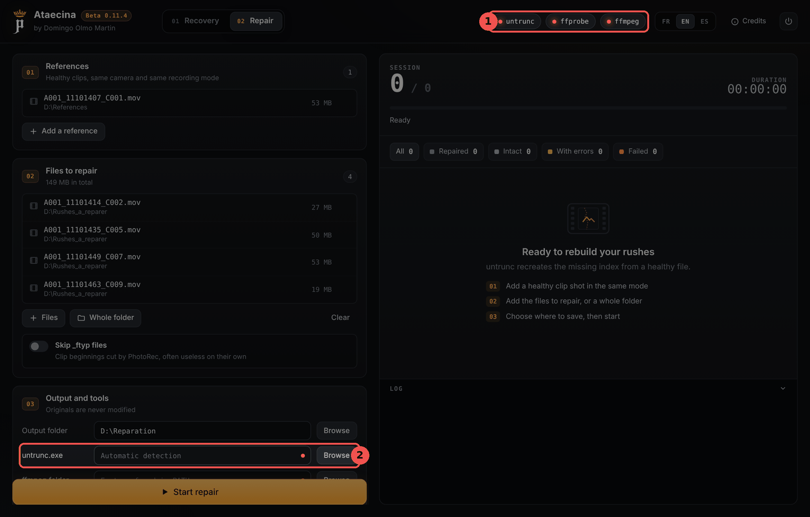</p>

If you start the repair anyway, Ataecina stops with a clear message (1), for example "untrunc.exe not found":

<p align="center">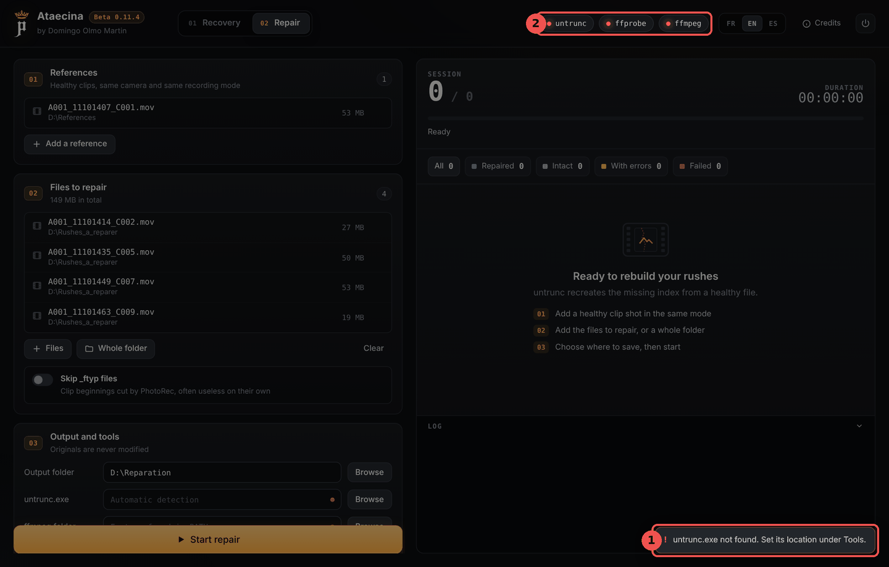</p>

Once the tools are next to the executable, the pills turn green (1) and the path found is shown (2). If they stay red, close and restart Ataecina.

<p align="center">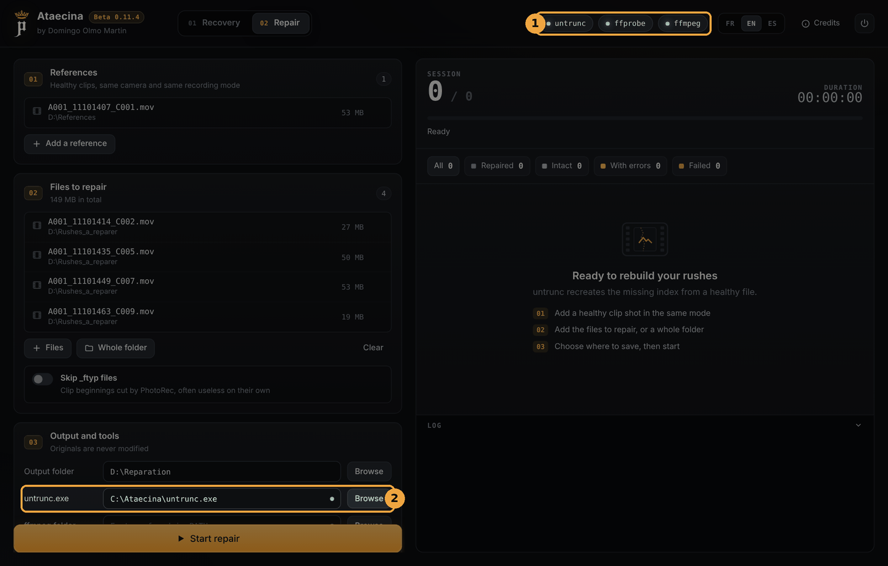</p>

In the Recovery tab, the **photorec** pill works the same way:

<p align="center">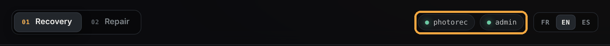</p>

**What works without the tools:** reading the card, the deep search, copying the files found, restoring the format and creating a card image. **What does not:** the PhotoRec search (without PhotoRec) and the whole repair (without untrunc and FFmpeg).

## 4. Before you start: good habits

- **Stop writing to the card.** Do not shoot on it, do not format it, do not copy anything to it. Every write can overwrite a clip that could still be recovered.
- **If Windows offers to format the card, say no.**
- **Always choose a destination on another drive** than the card being analysed. Ataecina reminds you below the Destination field.
- **For a damaged card, create an image first** (section 8): the card is read only once, and all the work then runs on the image.

## 5. Recovery: reading the card

This is the method to try first. Ataecina reads the card's exFAT or FAT32 file system itself, without writing anything to it, and finds the original folders and names, including deleted files.

<p align="center">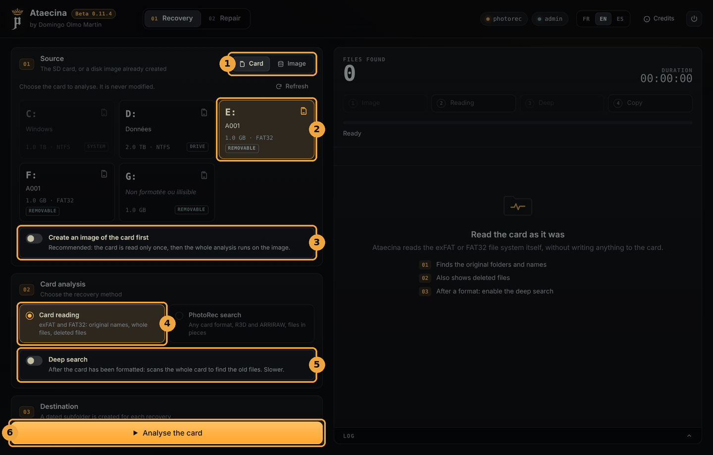</p>

1. **Source**: *Card* for a card in the reader, *Image* for a disk image already created.
2. **Choose the card** in the list. System drives are greyed out. If the card does not show up, click **Refresh**.
3. **Create an image of the card first**: recommended if the card seems damaged (section 8).
4. **Method**: *Card reading*.
5. **Deep search**: only after a format (section 6).
6. Check the **Destination** (a dated subfolder is created there for each recovery), then click **Analyse the card**.

### Choosing the files to copy

<p align="center">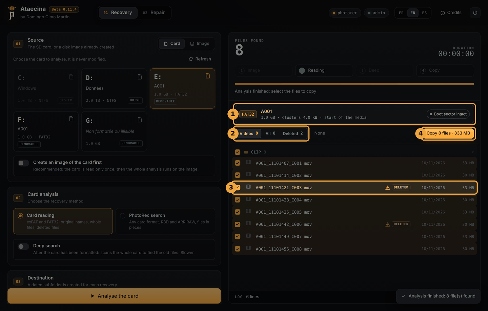</p>

1. The **volume card**: format (exFAT or FAT32), name, size, and the state of the boot sector.
2. The **filters**: *Videos*, *All*, *Deleted* (and *Recovered* after a deep search). *None* / *All* unticks or ticks everything.
3. **Deleted** files are marked *DELETED*, with a warning triangle: their data may have been partly overwritten since.
4. **Copy** copies the ticked files to the destination. The button shows their number and size.

<p align="center">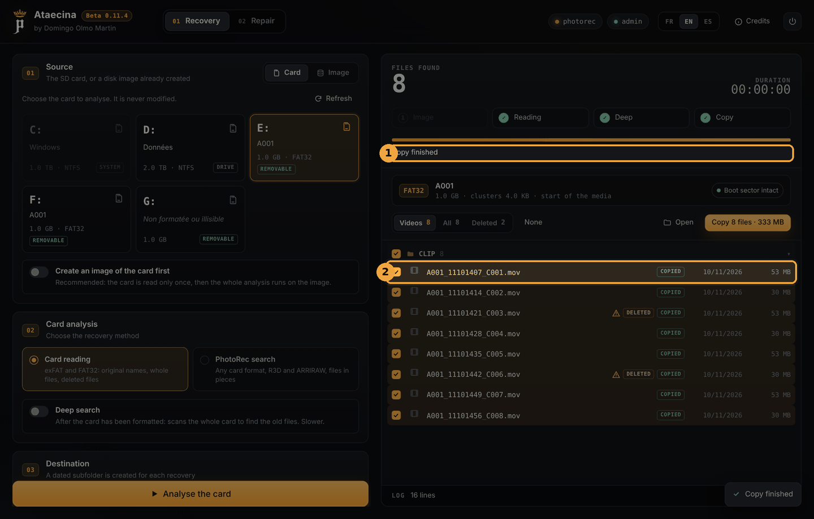</p>

When the copy is finished (1), each file has a status (2): *COPIED*, *TO REPAIR* (the file was copied but does not play) or *ERROR*. **Open** shows the copy folder.

The **Send videos to repair** option (under Destination) adds the unplayable videos straight to the list in the Repair tab.

## 6. Recovery: card formatted by mistake

After a format, the card looks empty: the simple reading finds nothing. Turn on the **deep search** and run the analysis again.

<p align="center">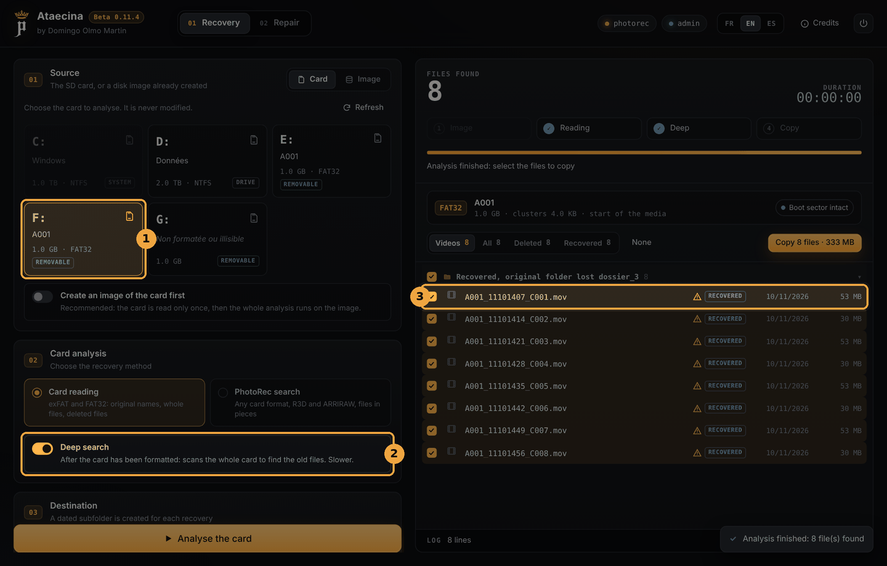</p>

1. Choose the formatted card.
2. Turn on **Deep search**. Ataecina scans the whole card for the old file entries. It takes longer.
3. The files found are marked *RECOVERED* and grouped under "Recovered, original folder lost". Their original names are often kept, but the original folder is lost, and their data is assumed to be in one piece: check them after copying.

If the deep search finds nothing, try the PhotoRec search (section 8).

## 7. Recovery: unreadable card, restoring the format

When Windows no longer recognises a card ("the disk is not formatted"), its boot sector is often damaged. exFAT and FAT32 cards keep a **backup copy** of it: Ataecina uses it to read the card anyway.

<p align="center">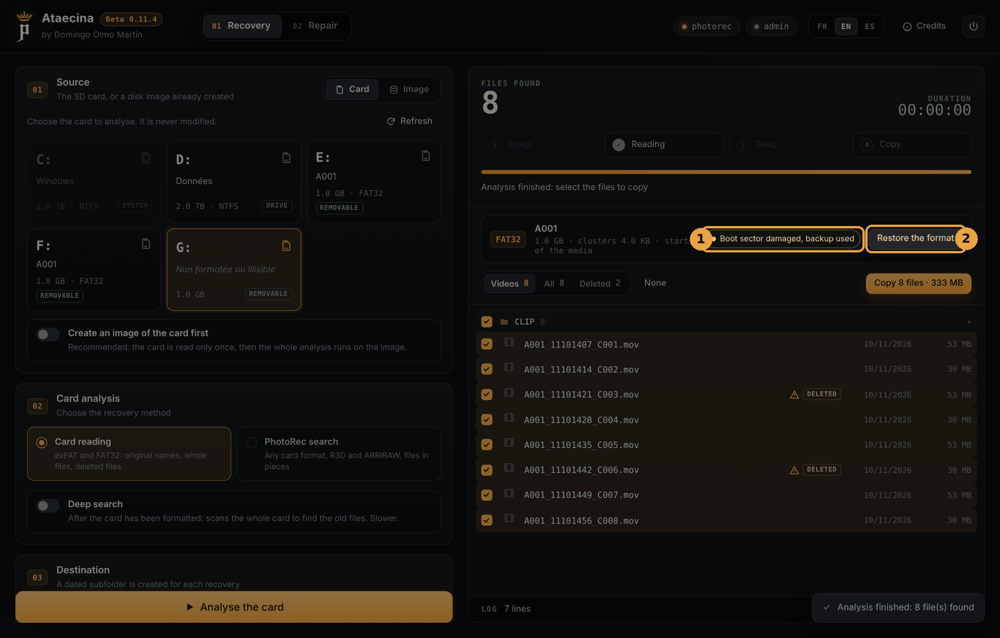</p>

1. The volume card reads *Boot sector damaged, backup used*. The files are listed normally: **copy the ones that matter first.**
2. **Restore the format** rewrites the boot sector from its backup copy, so that Windows can read the card again.

<p align="center">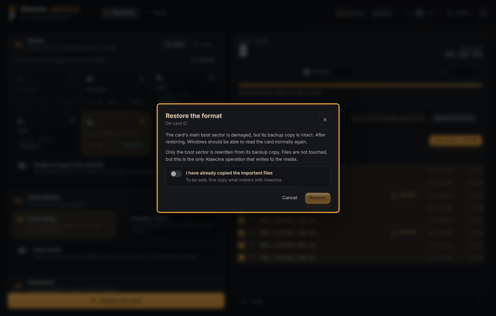</p>

This is **the only Ataecina operation that writes to the card**. Only the boot sector is rewritten, the files are not touched. To be safe, Ataecina asks you to confirm that you have already copied the important files before the **Restore** button is enabled.

## 8. Recovery: card image and PhotoRec search

### Creating a card image

A card that is starting to fail may not survive several reads. Turn on **Create an image of the card first**: Ataecina copies it entirely into an image file, reading the healthy areas first and the damaged ones last, following the GNU ddrescue method. An interrupted copy can be resumed. The whole analysis then runs on the image, and the card can be put away.

Allow **as much free space as the size of the card**. The **Image folder** field lets you choose where to save it (empty = the destination folder).

<p align="center">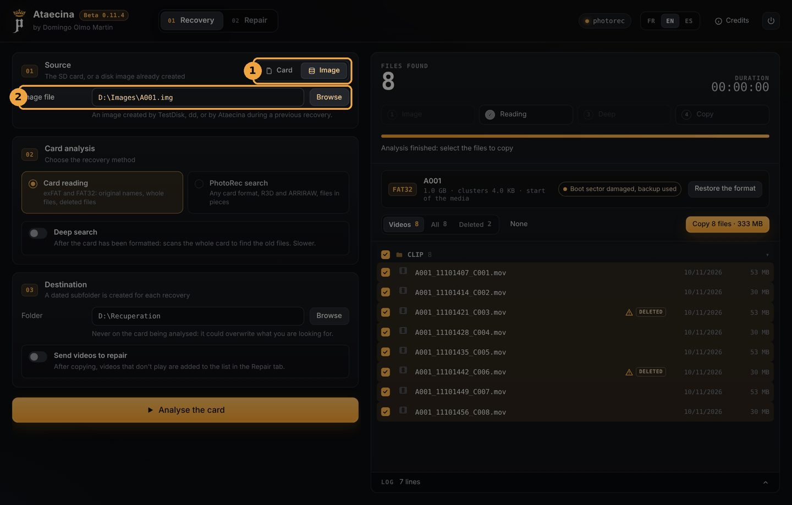</p>

To analyse an existing image, choose **Image** (1) in the source, then give the **image file** (2): an image created by Ataecina, TestDisk or dd.

### PhotoRec search

For cases where reading the card is not enough: destroyed file system, unknown card format, files scattered in pieces. PhotoRec searches for videos directly in the card's raw data. **PhotoRec must be installed** (section 3).

<p align="center">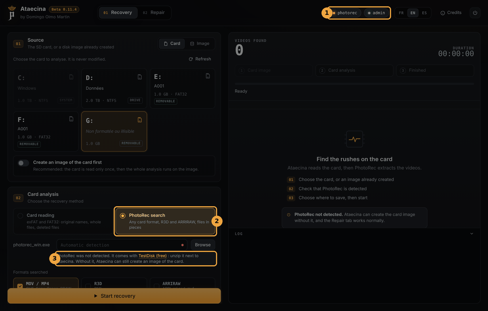</p>

1. The **photorec** pill must be green.
2. Choose the **PhotoRec search** method.
3. If PhotoRec is not detected, Ataecina says so here, with a link to TestDisk. You can also give the location of `photorec_win.exe` in the field above.

Choose the **formats searched** (MOV / MP4, R3D, ARRIRAW), then click **Start recovery**. Videos appear as they are found. PhotoRec does not recover the original names, and files in pieces often need repairing: at the end, Ataecina offers to send the MOV files to the Repair tab.

## 9. Repairing broken MOV and MP4 files

A MOV or MP4 file holds the images and an **index** that says where they are. If the camera shuts down while recording, the index is never written and the file no longer opens. untrunc rebuilds that index based on a **healthy reference clip**. You need **untrunc and FFmpeg** (section 3).

<p align="center">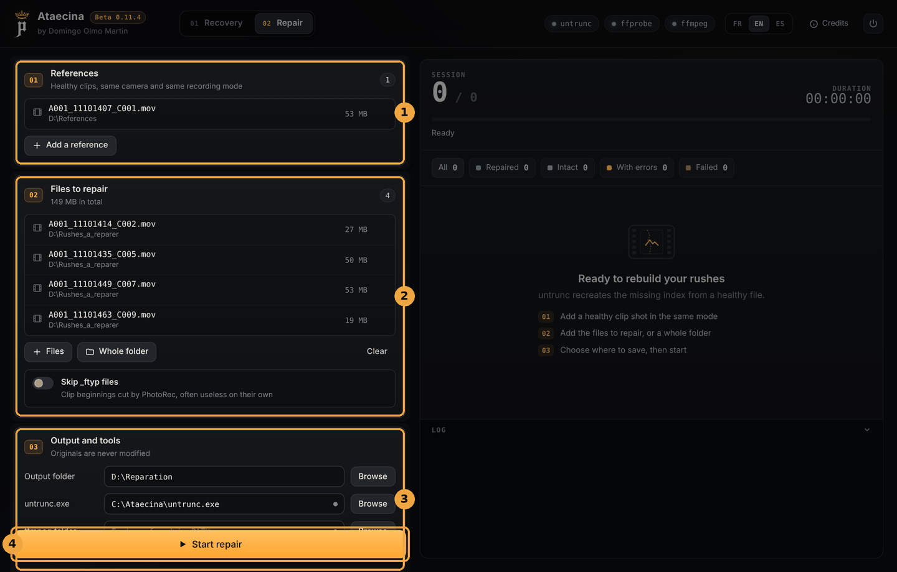</p>

1. **References**: add one or more **healthy** clips, a few seconds is enough, shot **with the same camera and the same recording mode** (resolution, frame rate, codec, bitrate) as the lost files. This is the single most important condition for success.
2. **Files to repair**: add files one by one (**Files**) or a whole folder (**Whole folder**, for example PhotoRec's output). The **Skip _ftyp files** option leaves out clip beginnings cut by PhotoRec, which are often useless on their own.
3. **Output and tools**: the **output folder** where the repaired files are written, and the location of the tools if Ataecina does not find them on its own. **Full check** decodes each repaired file entirely with ffmpeg to count errors (slower, safer).
4. Click **Start repair**.

For each file, Ataecina first checks whether it already plays. If not, it tries untrunc with each reference, in normal mode then step-by-step mode, and keeps the best result.

<p align="center">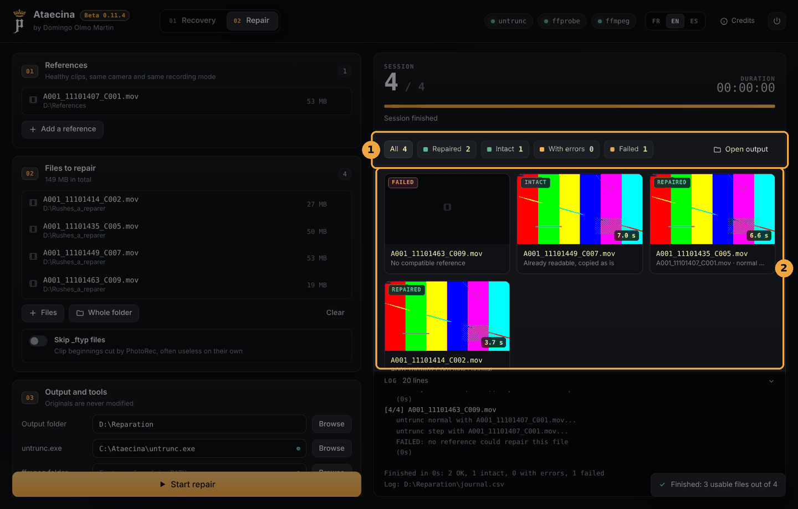</p>

1. The **summary**: *Repaired*, *Intact*, *With errors*, *Failed*. Clicking a category filters the results. **Open output** shows the output folder.
2. A **thumbnail** for each file, with the duration recovered:
   - **REPAIRED**: rebuilt, saved as `<name>_repare.mov`;
   - **INTACT**: already played, copied as is;
   - **ERRORS**: rebuilt, but decoding errors remain;
   - **FAILED**: no reference could repair it. Try another reference, shot in exactly the same mode.

Originals are never modified. The output folder also holds `journal.csv` (the result for each file, to open in a spreadsheet) and a `logs` folder with the details of every untrunc attempt.

## 10. FAQ

**Repair does not start: "untrunc.exe not found".**
untrunc is not next to `Ataecina.exe`, or its .dll files are missing. See section 3.

**The photorec pill stays red.**
The TestDisk folder must be unzipped and placed, whole, next to `Ataecina.exe` (or in `tools`). Otherwise, give the path of `photorec_win.exe` in the field provided.

**My card does not show up in the list.**
Click **Refresh**. Check that Ataecina is running as administrator. If Windows does not see the card at all (not even in Explorer), the reader or the card may be at fault: try another reader.

**Does Ataecina run on a Mac?**
No, Ataecina is Windows only.

**Which cards can Ataecina read?**
Card reading handles exFAT and FAT32, the formats of almost every camera card. For other cases, the PhotoRec search works with any card format.

**A repaired file is shorter than expected.**
untrunc recovers everything usable. If the end of the file was never written to the card, it cannot be rebuilt.

## 11. Disclaimer and license

Ataecina is a tool to help recover and repair media. It is provided "as is", without any warranty: recovery is never guaranteed, and the author cannot be held responsible for any loss, corruption or deletion of data. For irreplaceable footage on a physically damaged card, contact a data recovery professional before doing anything.

untrunc, FFmpeg and TestDisk / PhotoRec remain the property of their authors and are distributed under their own licences.

© 2026 Domingo Olmo Martin. Released under the [MIT License](../LICENSE).
